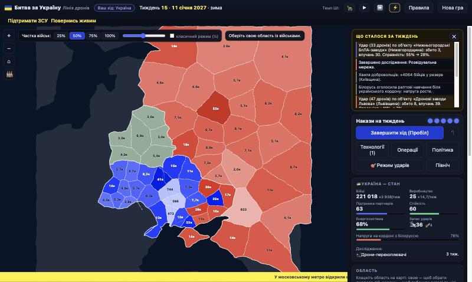

# Битва за Україну: Лінія дронів

Покрокова стратегія в браузері на схематичній карті Східної Європи. Натхненна простою грою
«Битва за Україну» (автор — MaxD): карта областей, число бійців у кожній, один клік — одна дія.
Тут цю ідею доповнено тим, що з’явилося за чотири роки війни: **дрони та контрзаходи, далекобійні
удари по тилу, ППО, спецоперації, гонка технологій, Білорусь як «друга загроза»** і можливість
грати за будь-яку зі сторін.

**Грати онлайн:** https://serge-sotnyk.github.io/battle4ua-ccode/



## Швидкий старт

Потрібен Node.js 20+ (перевірено на 22).

```bash
npm install
npm run dev        # http://127.0.0.1:5273
```

Інші команди:

| Команда | Що робить |
|---|---|
| `npm test` | 59 тестів: карта, правила, технології, удари, спецоперації, ШІ, збереження, «фаззинг» наказів |
| `npm run typecheck` | перевірка типів |
| `npm run build` / `npm run preview` | продакшн-збірка у `dist/` (статика, ≈160 КБ) і її перегляд |
| `npm run sim -- 8 [--normal|--ru] [--diff=easy|normal|hard] [--feb] [--boost] [--verbose]` | симуляція «ШІ проти ШІ» для підбору балансу |

Гра — чисто клієнтська статика: без сервера, акаунтів і мережі. Деплой — будь-який статичний хостинг
(GitHub Pages, Netlify, Cloudflare Pages тощо) після `npm run build`.

## Як грати

* **Один хід = один тиждень.** На тиждень є 4 накази (залежно від складності людині дають +1/+2,
  технологія «Єдина система управління» додає ще один).
* Клацніть **свою область** (вона стане жовтою), потім **сусідню**: свою — *перекидання*, ворожу — *атака*.
  Частку військ задає панель внизу (25/50/75/100 % або «класичний режим» — завжди половина).
  Наведіть курсор на ворожу область — побачите прогноз бою.
* **Безкоштовні** дії: дослідження, політика (мобілізація, частка виробництва на дрони/ракети),
  розгортання ППО. **Платні** (1 наказ): перекидання, атака, удар, укріплення, спецоперація.
* **Тил**: значки 🛢️ ✈️ 🏭 💥 ⚡ ⚓ 🌉 на карті (клавіша `F` або режим ударів `S`) — НПЗ, аеродроми,
  виробництво дронів, склади, електростанції, порти, Кримський міст. Удари вражають економіку,
  стійкість і бойові можливості ворога.
* **Перемога**: звільнити всю Україну · довести ворожу *стійкість* до нуля · (для РФ) узяти Київ.
  За ліміту в 156 тижнів — перемир’я, результат залежить від кількості областей України під контролем УА.
* Повні правила — кнопка «Правила» у грі.

Клавіші: `Пробіл` завершити хід · `Z` скасувати наказ · `1–4` частка військ · `T` технології ·
`S` режим ударів · `F` об’єкти · `Esc` скасувати вибір · колесо миші — масштаб, перетягування — пересування.

### Режими

* Україна / Росія — проти ШІ. Три складності: **Легка**, **Звичайна** (як «звичайний режим» оригіналу:
  втрати ШІ більші), **Тяжка**. Для кожної сторони таблиця своя (РФ за замовчуванням сильніша, тому
  проти людини-РФ ШІ-Україна отримує бонуси).
* Два сценарії: **Жовтень 2026** (основний) і **Лютий 2022 — «класика»** (стартова розстановка оригінальної
  гри, мало технологій, Білорусь вступає за кілька тижнів).
* Двоє гравців за одним комп’ютером (з екраном передачі керування).
* Спостерігач: ШІ проти ШІ з регульованим темпом.
* Автозбереження в `localStorage` браузера після кожного наказу.

## Що нового порівняно з оригіналом

| Оригінал | Тут |
|---|---|
| 25 областей України | ≈60 областей: Україна (Херсонщина та Донеччина розділені), Білорусь, європейська Росія |
| Одна дія за день | Тиждень і 4 накази; повзунок частки військ |
| Лише наземні бої | + удари дронами й ракетами, ППО, укріплення, логістика |
| Без економіки | Виробництво, допомога партнерів / нафтові доходи, енергосистема, стійкість |
| Раптовий удар з Білорусі | Шкала напруги: видно, як росте, і є чим відповісти |
| Тільки за ЗСУ | Можна грати за Росію — інша асиметрична гра |
| — | 39 технологій із контрзаходами (РЕБ ↔ FPV ↔ оптоволокно ↔ сітки …) |
| — | Спецоперації («Павутина», Кримський міст, диверсії, кібератаки), випадкові події |

## Архітектура

```
src/
  engine/            чистий, детермінований рушій (жодного DOM; працює в Node)
    map/             контури країн → діаграма Вороного → полігони областей, суміжність
    config.ts        ВЕСЬ баланс в одному місці
    techs.ts         дерево технологій + контрзаходи + обчислення модифікаторів
    combat.ts        бойова модель (лінійний Ланчестер з перевагою оборони)
    orders.ts        єдиний диспетчер наказів для людини й ШІ
    strikes.ts ops.ts events.ts turn.ts victory.ts  підсистеми
    scenario.ts scenarios.ts  стартові розстановки («Жовтень 2026», «Лютий 2022»)
    ai.ts            ШІ (оцінка атак, перекидання, удари, дослідження, ППО)
  ui/                SVG-карта, панелі, модальні вікна, стор
  main.ts            зв’язування подій
tests/               vitest
scripts/simulate.ts  симулятор «ШІ проти ШІ»
docs/DESIGN.md       дизайн-документ: формули, числа, міркування
```

Головні рішення:

* **Карта генерується в коді, без завантажених геоданих.** Контури Україна/Білорусь/Росія задані
  вручну спільними «дугами» (щоб кордони збігалися), області — це «зважена діаграма Вороного» від
  опорних точок, обрізана контуром; межі «розхитані» гладкою функцією від координат. Суміжність
  обчислюється з геометрії й перевіряється тестами. Це стилізація, не картографія.
* **Рушій не знає про інтерфейс.** Увесь стан — простий JSON (`GameState`), випадковість — у
  `mulberry32` зі станом у самому стані: партії відтворювані, збереження тривіальне, а скасування
  наказу не дає «перекидати кубики».
* **Людина й ШІ користуються тим самим `applyOrder`.** ШІ не має прихованих можливостей.

## Баланс і налаштування

Усі числа — у [`src/engine/config.ts`](src/engine/config.ts) (бій, економіка, удари, складності, пороги
перемоги), а технології — у [`src/engine/techs.ts`](src/engine/techs.ts). Після змін:

```bash
npm test
npm run sim -- 8 --normal      # як ШІ-Україна (прибл. «людина») грає проти ШІ-РФ
```

Поточні орієнтири (30 партій, `--normal`: ШІ-Україна грає за «людину» проти ШІ-РФ): ≈45% партій закінчуються
перемир’ям на умовах РФ, ≈50% — нічиєю, рідко падає Київ; в середньому УА втрачає 5–7 областей за 3 роки — тож
кваліфікований гравець має простір для гри. Гра за РФ проти ШІ-України: Легка ≈ 90% перемог «гравця», Звичайна ≈ 45%,
Тяжка ≈ 25% (решта — нічиї).

## Обмеження та ідеї розвитку

* Карта — схематична; розстановка сил — ігрова умовність, не документальна.
* Немає фронтових «секторів» у областях і звуку; на телефоні працює pinch-масштаб, але інтерфейс орієнтований на десктоп.
* Ідеї: кампанія за етапами (2022 → 2026), онлайн-PvP, відео-полігон, тонше налаштування ШІ,
  історія партій і «поділитися результатом» як зображення.

## Подяки

Ідея і стиль — проста гра «Битва за Україну» (MaxD). Підтримати ЗСУ:
[United24](https://u24.gov.ua/) · [Повернись живим](https://savelife.in.ua/).
